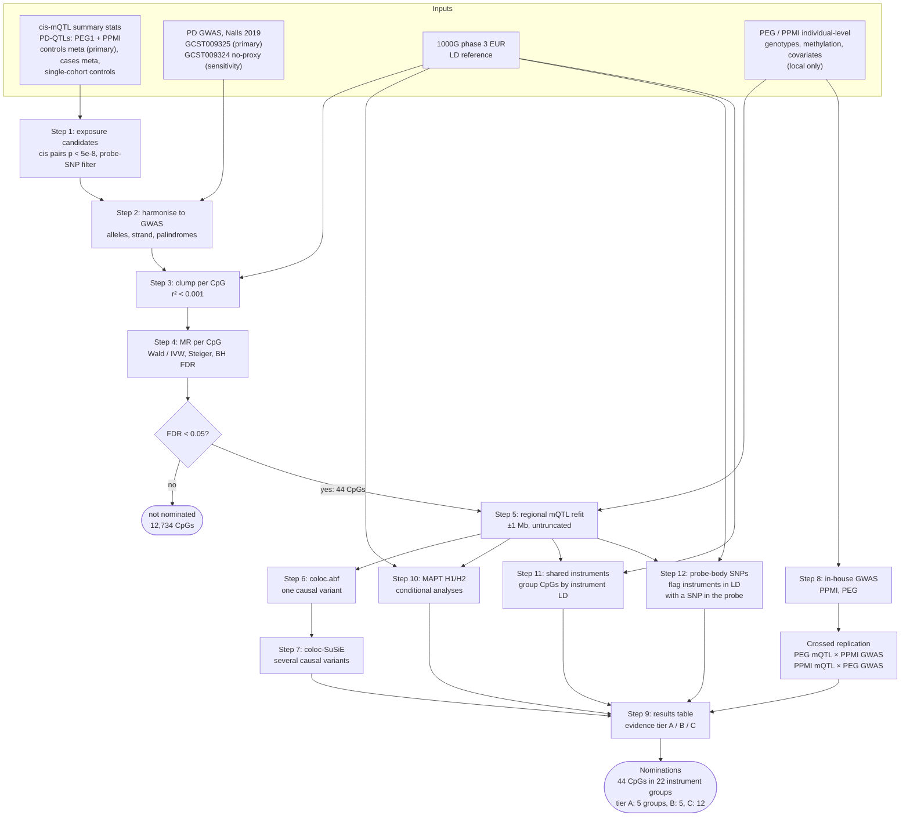
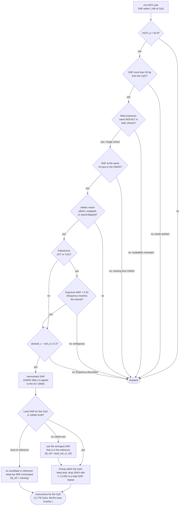
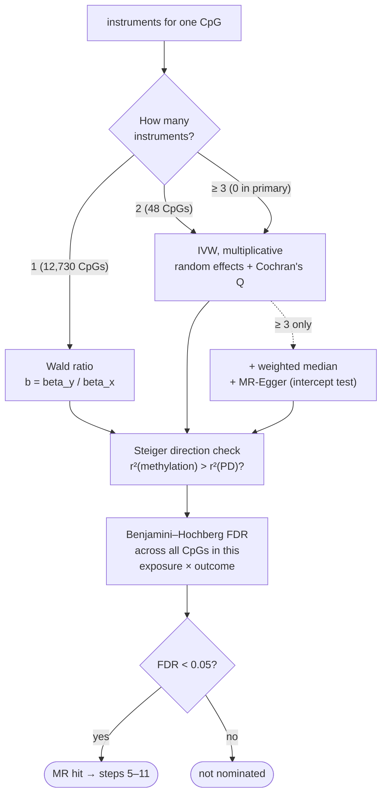
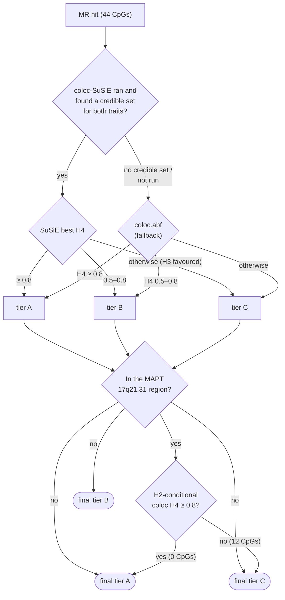
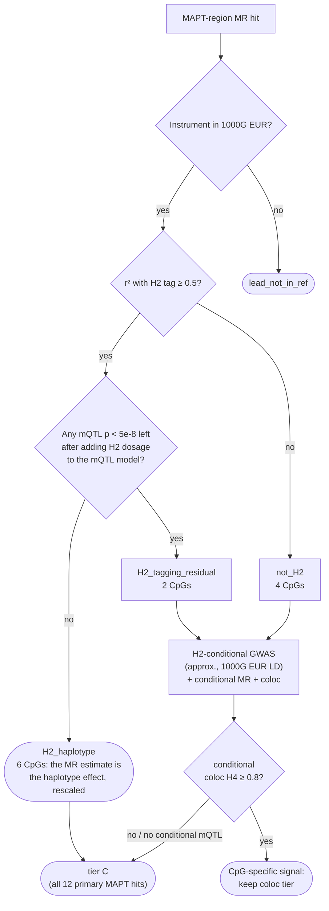
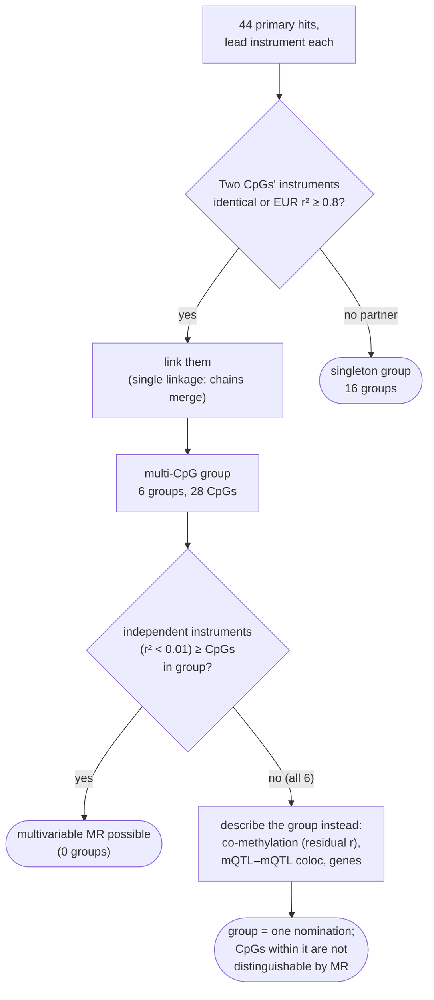

# Phase 1 flowchart

How Phase 1 (two-sample MR nomination) runs from inputs to the final tiered
shortlist, with the decision points at each step. Script numbers refer to
`scripts/R/NN_*.R`; column definitions are in
[`phase1_output_spec.md`](phase1_output_spec.md). Counts are for the primary
analysis (controls mQTL meta × Nalls 2019 GCST009325).

## 1. Overview

Mandatory run order: 1 → 2 → 3 → 4 → 5 → 6 → 7 → 8 (steps 1–4 again for the
crossed pairings) → 10 → 11 → 12 → 9.

## 2. Building instruments (steps 1–3)

Applied to every (SNP, CpG) pair in each exposure dataset.

About 2% of exposure SNPs are lost at the GWAS steps (`harmonised/summary.tsv`).
The GWAS p-value is never used to choose instruments.

## 3. MR estimate per CpG (step 4)

The same steps 1–4 run for every exposure × outcome pairing: the sensitivity
exposures (cases meta, PEG1 controls, PPMI controls), the no-proxy GWAS, and the
crossed in-house pairings.

## 4. Evidence tier (steps 6, 7, 10 → 9)

MR with one instrument can't tell "the same variant drives methylation and PD"
from "two different variants in LD". Colocalization decides that, and sets the tier.

Not shown because they don't change the tier: coloc-SuSiE with the no-proxy GWAS,
crossed replication, the sensitivity exposures, and the probe-body SNP flag
(step 12, `probe_snp_ld`). They are reported as columns
next to the tier.

## 5. MAPT H1/H2 classification (step 10)

The 17q21.31 inversion makes the H1/H2 haplotype a single ~1.5 Mb LD block. The H2
tag (rs8070723, G allele) is itself a genome-wide mQTL for 45 CpGs.

## 6. Shared instruments (step 11)

